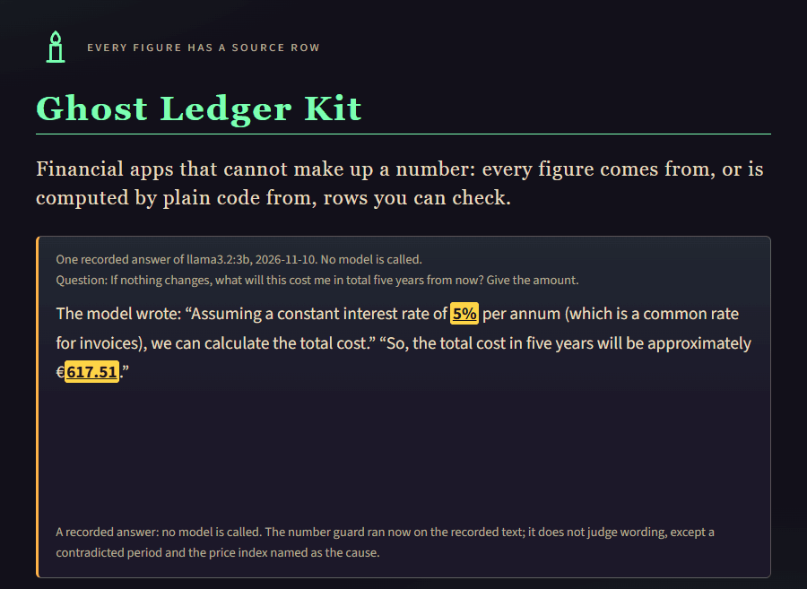

# Ghost Ledger Kit

Financial apps where an LLM may word the explanation but cannot slip in a figure: any amount or IBAN that is not in the cited rows or the alert data, in digits or in English or Spanish words, or any such date in digits or with an English month name, sends the card back to a fixed template. It checks figures, not meaning (see What the guard does not check).

- Live app: not deployed yet; it will be on Streamlit Community Cloud, and the link will go here. Until then it runs locally in four commands, see Try it in [docs/developing.md](docs/developing.md).
- Demo video: not recorded yet; the link will go here and on the Devpost page.

## For judges: 60 seconds

No key is needed; the steps below work on the hosted app once it is deployed, or on a local run ([docs/developing.md](docs/developing.md)).

1. Open Home. Once the page has loaded, the moment plays in under three seconds (a cold load takes longer): one recorded answer of a real model (`llama3.2:3b`) that assumed a 5% interest rate found in no row and built 617.51 on it, and the number guard striking both figures out and showing a fixed template instead. Each app tile shows that app's own drawing, and the rest of the text is under *How it works*.
2. Open Zombie Subscriptions. The demo loads by itself.
3. Each card shows a drawing from its cited rows and the recorded real answer, re-checked by today's number guard and labelled *No model called*. This holds for the CSV demo that loads by itself; the Real formats and Norma 43 demos have no recording.
4. On the GYMPLUS card, open *Provoke the LLM* and replay the five-year question. The model asks the kit for `yearly_cost` × 5 in a placeholder, the kit computes 539,40 EUR and shows the formula (`5 x yearly_cost 107,88 EUR = 539,40 EUR`); a figure the model writes itself is still checked against the rows. On the Vampire Fees overdraft card, the recording also holds a rejected calculation: a total added to its own parts.
5. On most cards, open *Exorcise* to get the refund request or the bank complaint. An alert with nothing to claim, such as an unpaid invoice or an invalid IBAN, has no draft.

To run it live with a local model, see `docs/live-guard.md`.

## The three apps

All three apps are built on the same `ledger_kit` library and share nothing else.

- **Zombie Subscriptions** (`apps/zombie_subscriptions/`) is for individuals and finds forgotten subscriptions in a bank statement.
- **Phantom Invoices** (`apps/phantom_invoices/`) is for small Spanish businesses and finds duplicate invoices, supplier IBAN changes and invalid IBANs, VAT errors, and overdue invoices or payments that match no invoice.
- **Vampire Fees** (`apps/vampire_fees/`) is for individuals and small businesses and finds the bank fees that drain an account.

How it works, the detectors of each app and the demo numbers are in [docs/how-it-works.md](docs/how-it-works.md).

## How we used Kiro

| Kiro feature | What we did | Why it mattered |
|---|---|---|
| Specs | 18 specs in `.kiro/specs/`, each with `requirements.md`, `design.md` and `tasks.md`: `ledger-core`, `zombie-subscriptions`, `phantom-invoices`, `showcase`, `public-cpi` (INE price-index context), `real-formats` (Norma 43 and Facturae), `benchmark`, `detector-fixes` (the corrections the benchmark found), `vampire-fees` (the third app), `live-guard` (the Provoke the LLM panel), `haunted-design` (the look), `judge-path` (recorded real answers for visitors without a key), `exorcise` (action drafts), `scan-command` (the command-line scan), `cli-hooks` (the hooks that run in the CLI), `guard-honesty` (numbers written in words, an honest Home example and labels), `app-signatures` (a drawing per app on every alert card, from the cited rows only) and `model-computes` (the model names a calculation, the kit computes it from the alert fields and shows the formula). Tasks are ticked off as work was done; the boxes still open are checks and runs left to a person, plus HD22, done but not ticked. Amendments are recorded in the specs, for example REQ-PI-09 and REQ-ZS-10a; A-LG-01 to A-LG-03 in `live-guard` came from real model answers. | Each rule that keeps figures honest (cite the source row, no invented number) is a numbered requirement with a test, so the promise is written down before the code. |
| Steering | Six files in `.kiro/steering/`. Five are always included: `product.md`, `tech.md`, `structure.md`, `testing.md` and `finance-rules.md`. One is manual: `update-kiro-usage.md`, used to rewrite this section. | `finance-rules.md` makes "never invent a figure, always cite the source row" binding on every change, and it carries the exact no-invention wording the explainer prompt must use. |
| Hooks | `.kiro/hooks/review-gate.json` holds two Kiro CLI hooks written on 12 Nov (spec `cli-hooks`): `lint-after-write` (PostToolUse on the write tools: `ruff check` and `ruff format --check` on each `.py` file Kiro writes, and the findings go back to Kiro) and `tests-on-stop` (Stop: `ruff check .` and `pytest` on the test folders of the parts Kiro touched; it always exits 0). Every run adds a line to `data/hook_runs/hook_log.jsonl`. They loaded during the call that wrote them: 12 writes in that call, 8 of them lint runs on the test file being written (`tests/test_kiro_hooks.py`), 4 non-Python files skipped, then once on stop. All 8 lint runs failed: each reported E501 (line too long), and one also reported F821 (undefined name), which was gone from the next write; the E501 was fixed in the following call. The stop run reported the same E501 and ran 2,137 tests, all passing. In the next call the stop run caught a README test that failed, and the call after that fixed it. The three IDE hook files, `detector-guard.kiro.hook`, `samples-sync.kiro.hook` and `kiro-usage.kiro.hook`, are not read by the CLI, so they never ran here; they are kept for anyone who opens the repo in the Kiro IDE. | In this build Kiro has no shell, so it could not run `ruff` or the tests itself; the hooks gave it that feedback without giving it a shell, and the log shows when they ran. |
| MCP | The context7 MCP server (remote, no API key) is configured in `.kiro/settings/mcp.json` after the developer approved it. The agent used it in sessions 5c, to check the Streamlit, pandas and Hypothesis behaviour the code relies on (results in `docs/mcp-api-checks.md`, no mismatch), and 8a, to look up `defusedxml` before writing the Facturae reader (notes in section 6 of `.kiro/specs/real-formats/design.md`). | Library APIs change between releases, so the assumptions behind the code were checked against current docs instead of memory. |
| Property-based testing | Hypothesis tests with `max_examples=200` in `tests/` and in `apps/*/tests/`. The no-invention property uses `loaded_source_refs` from `ledger_kit/detectors/` and asserts that every cited `source_ref` belongs to a loaded input; see `apps/phantom_invoices/tests/test_pi_vat_error.py` and `apps/zombie_subscriptions/tests/test_zs_price_increase.py`. | It checks the core promise on generated inputs, including dirty cells, not only on hand-picked examples: no alert may cite a row that was not loaded. |
| Powers | One local power, `powers/ghost-ledger-detector/`, with the `add-detector` skill in `powers/ghost-ledger-detector/skills/add-detector/SKILL.md`. The skill was loaded into the custom agent through a `skill://` resource in `.kiro/agents/ghost-ledger-builder.json`. | It teaches an agent to add a new detector the same way as the existing ones, with the namespaced registration, source refs and tests, so a new detector keeps the contract. |
| Custom agent | `.kiro/agents/ghost-ledger-builder.json` with its prompt `.kiro/agents/ghost-ledger-builder.md`. It loads the five always-included steering files, `update-kiro-usage.md`, `README.md` and the `add-detector` skill, and may use the context7 MCP server. It reads and writes files only, so it cannot run commands. It built the Vampire Fees app (`apps/vampire_fees/`). | The agent starts with the finance rules in its context and a hard boundary (no edit of `ledger_kit/` or another app), so a new app inherits the no-invention contract; `git diff` showed zero changes to the library and the other two apps. |
| Kiro CLI | Built non-interactively in spec mode, one fresh conversation per phase; the reviewer ran the tests between calls. | Different from the IDE: it does not read the IDE hook files but runs the JSON hooks in `.kiro/hooks/`, no panels, scriptable, and every call is a prompt file in `kiro_prompts/` and can be rerun with `run_kiro.ps1`. |
| Spec-driven versus vibe coding | Vampire Fees was built by the custom agent from its spec with zero changes to `ledger_kit/` and the other apps. The benchmark found two detector bugs, fixed in the `detector-fixes` spec: precision 0.9719 → 0.9980 (Zombie Subscriptions) and 0.7742 → 1.0000 (Phantom Invoices), see `docs/benchmark.md`. Six recorded runs of real model answers are in `data/live_runs/` (three of 10 Nov, one each of 11, 15 and 16 Nov); the first three led to A-LG-01 to A-LG-03 and their regression tests, and the apps replay the 16 Nov run. | A written requirement can be checked by a test and by a diff; a chat request cannot. These numbers come from files in the repo. |

Kiro documentation: [kiro.dev/docs](https://kiro.dev/docs/).

## Who did what

This is a student project. I chose what to build and directed it: the goal, the focus on Spanish bank and invoice data, the official formats, the real-model test, the adversarial reviews, and every decision marked *Me* below. Kiro wrote the code. Claude Code, an AI coding assistant, proposed options, including the two first ideas I chose between, drafted the prompts and ran the tests. The table says who proposed and who decided each choice.

- **Me (Alessandro Lair, student):** chose to build for Spanish bank and invoice data instead of a generic money app; turned down the first version as too simple and asked for the official formats (Norma 43, Facturae), public data (INE CPI) and a measured benchmark; asked for the guard to be tested against a real model before the video and approved running one locally; asked for an adversarial review against past winners before recording; decide what is published and when.
- **Kiro (CLI, spec mode and a custom agent):** wrote every spec, test and line of code in this repository; the reviewer filled in only the records of Kiro calls in the task lists.
- **Claude Code (AI coding assistant):** proposed options, drafted the prompts and sent them to Kiro CLI on my account, ran the tests and the benchmark, and sent every failure back to Kiro.

| Date | Decision | Proposed by | Decided by |
|---|---|---|---|
| 23 Oct | Build Ghost Ledger Kit (Skeleton Crew) and not a COBOL tool, after reading the 2025 gallery | Claude Code (two options: this kit or a COBOL tool) | Me |
| 6 Nov | Hand the building to Kiro CLI, driven by the assistant, instead of the IDE | Me (to delegate), Claude Code (the CLI route) | Me |
| 9 Nov | Version 1 is too simple: add the official formats, INE data and a benchmark | Me (the concern), Claude Code (the three additions) | Me |
| 9 Nov | Turn on the Context7 MCP server | Claude Code | Me |
| 10 Nov | Test the guard against a real model, locally with Ollama | Claude Code | Me |
| 10 Nov | Adversarial review against past winners before the video | Me | Me |
| 12 Nov | Make the hooks run in the CLI build (lint after every write, tests on stop, a log in the repo) | Claude Code, after the adversarial review found that the hooks never ran | Claude Code, within my general go-ahead to keep improving the project |
| 13 Nov | Read number words in the guard, and make the Home example a real invention, after a fresh jury showed that 539.40 is right arithmetic and that five hundred and forty euros passed | Claude Code, after the fresh jury | Claude Code, within my go-ahead to keep working through the night |
| 13 Nov | Give each app its own drawing on every alert card (a pulse for Zombie, bites for Vampire, a lantern for Phantom), drawn only from the cited rows and checked by the number guard, after the fresh jury found the three apps looked the same | Claude Code, after the fresh jury | Claude Code, within my go-ahead to keep working through the night |
| 15 Nov | Home with one clear moment: the recorded invention appears and the guard strikes it out in under three seconds; the rest of the text moves into How it works; each app tile shows its own drawing | the adversarial review of 14 Nov, drafted by Claude Code | Me |
| 15 Nov | The model asks, the kit computes: placeholders that the kit evaluates from the alert fields, shown with their formula | the adversarial review of 14 Nov, drafted by Claude Code | Me |

## What the guard does not check

- **Meaning.** It checks that each figure is in the cited rows or the alert data. What the sentence says about the figure is not checked, with two exceptions. First, a period that contradicts the field a figure matches is rejected: on a monthly 10.99 charge, `MUSICBOX costs 10.99 EUR every year` now goes back to the fixed template, while `MUSICBOX costs 10.99 EUR per month` passes. Second, it rejects an answer that names the price index as the cause of the price change, because the kit promises the index is context only. Other meaning is not checked: `MUSICBOX raised its price to 10.99 EUR per month` passes on an alert where nothing rose. A figure that is only in the cited rows has no period to compare, so on the duplicate-subscription card the every-year sentence still passes.
- **Arithmetic.** The guard itself does none. A result the model writes by hand that is in no row is rejected (107.88 × 5 = 539.40 typed into the answer), and a figure that is in the rows passes whatever the sentence does with it. Arithmetic happens only when the model asks the kit through a placeholder, and the kit computes it from the alert fields.
- **Number words.** English and Spanish only. Any number above ten, or written with more than one word, is checked; ten or less only next to a currency or a percent. So `three months` and `one of them` pass, while `3 months` in digits is rejected when 3 is in neither the cited rows nor the alert data (on GYMPLUS, `post_cancellation_count` is 3, so it passes). Ordinals and other languages are not read, so a day written as `twenty-first` is not checked. An amount with cents in words is rejected even when right.
- **Truth.** An accepted answer is not a statement that it is true.

## More detail

- How it works, the three apps in detail and the benchmark method: [docs/how-it-works.md](docs/how-it-works.md).
- The real Spanish formats (Norma 43 and Facturae): [docs/real-formats.md](docs/real-formats.md).
- The INE price index context: [docs/public-data.md](docs/public-data.md).
- The generated benchmark results: [docs/benchmark.md](docs/benchmark.md).
- Running a local model against the guard: [docs/live-guard.md](docs/live-guard.md).
- Running it locally, the command-line scan, the tests and the project layout: [docs/developing.md](docs/developing.md).

## Data and licence

All demo and sample data in this repository is synthetic and generated by `scripts/generate_samples.py` with a fixed seed (42 by default), so regenerating gives the same bytes; this includes the Norma 43 and Facturae samples. There is no real personal or financial data; see `data/samples/README.md`.

- Company and person names are invented.
- IBANs pass the ISO 13616 mod-97 check but have deliberately wrong Spanish national check digits, so they cannot be real accounts. The one planted exception is the IBAN on invoice TR-2026-014, written with hyphens on purpose so that the app flags it as invalid; its digits still pass mod-97.
- Spanish tax ids carry a wrong control character, a different one per fictional supplier.

The one exception is `data/public/`: official public data from the INE (the consumer price index), under CC BY 4.0, and from the Banco de España (payment-account fees, below). The INE data has its licence reference and attribution in `data/public/README.md` and in `docs/public-data.md`. It contains no personal data. The INE data keeps its own licence (CC BY 4.0) and is not covered by the MIT licence of this repository. The Zombie Subscriptions page shows this notice once, below its alerts:

> Elaboración propia con datos extraídos del sitio web del INE: www.ine.es
>
> Licence: CC BY 4.0 · INE series IPC290751 (Nacional. Índice general. Índice.) · retrieved 2026-11-09
>
> The INE does not take part in, sponsor or support this reuse.

Released under the MIT licence, see `LICENSE`. The INE data keeps the INE licence.

The second source in `data/public/` is the Banco de España: the snapshot `data/public/bde_payment_account_fees.json` holds the payment-account fees that the entities declared to the Banco de España comparator, for the account type `CNO` (Cuenta Nómina/Pensión) only, declared and retrieved on 2026-11-23: 51 entities and 92 accounts. It was written by `scripts/import_bde_fees.py` from an Excel exported by hand and kept outside the repository; only complete account types enter it. Vampire Fees uses it to say how many of these accounts charge less than a recurring maintenance or debit-card fee it found; the figures are context, not a verdict, and never decide an alert. The app never calls the network: it reads the committed file. The fee comparison appears once the snapshot data/public/bde_payment_account_fees.json is committed; without it the app shows no comparison. The Vampire Fees page shows this notice once, below its alerts:

> Fuente: Banco de España, comparador de comisiones de cuentas de pago (declaraciones a fecha 2026-11-23). Elaboración propia: recuento, mediana y máximo.
>
> The Banco de España legal notice allows reuse and use for calculations if the information is reproduced faithfully and the Banco de España is cited as the source. The data keeps that condition and is not covered by the repository MIT licence.
>
> The Banco de España does not take part in, endorse or support this reuse.

Source, file facts and the import command are in `data/public/README.md`.

## Hackathon

Kiroween 2026, category Skeleton Crew: one template, three different apps (two of them read a bank statement and nothing else). A personal-finance tool for individuals, a bank-fee tool and an invoice-checking tool for small Spanish businesses are built on the same three layers and the same guarantee.

Tools used: [Streamlit](https://docs.streamlit.io/), [pytest](https://docs.pytest.org/), [Hypothesis](https://hypothesis.readthedocs.io/) and [Ruff](https://docs.astral.sh/ruff/).
